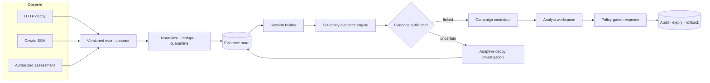
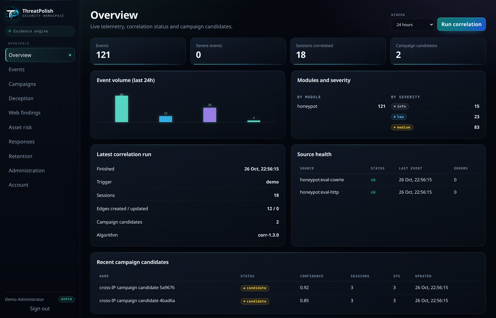
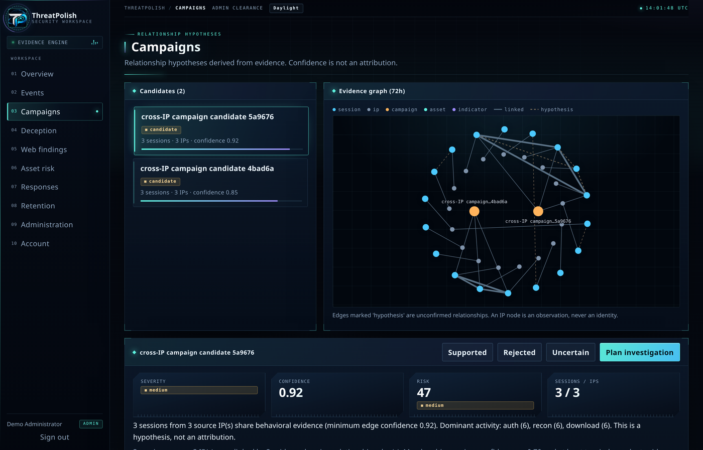
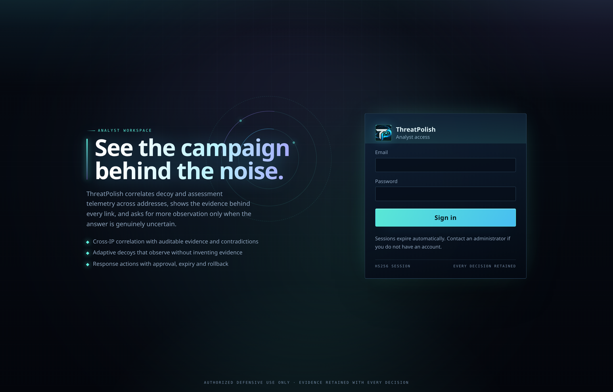

<p align="center">
  
</p>

<h1 align="center">ThreatPolish</h1>

<p align="center">
  <strong>Turn threats into intelligence.</strong><br />
  Evidence-guided campaign correlation with uncertainty-aware adaptive deception.
</p>

<p align="center">
  <a href="https://github.com/heyytrayamm/ThreatPolish/actions/workflows/ci.yml"></a>
  
  
  
  
</p>

> **Status — 1.0.0.** Self-hosted. The Docker/PostgreSQL path is verified end to
> end, including restart, backup/restore, database outage and live Cowrie
> ingestion. Benchmark results use synthetic telemetry; read the limitations
> before drawing operational conclusions.

ThreatPolish ingests telemetry from authorized decoys and assessments, correlates
sessions across IP addresses using explicit behavioural evidence, explains every
relationship it proposes, and can request additional observation through isolated
decoy profiles when the evidence is genuinely uncertain.

It does **not** identify attackers. It produces relationship hypotheses with
recorded evidence, confidence, contradictions and expiry, so an analyst can
decide what the evidence supports.

## The thesis

**Attribution is a graph problem, not a lookup.** An IP address is a disposable
routing coordinate. Behaviour, targeting and tooling are the durable signals.

**Specificity is the currency of evidence.** A shared `root` login or a stock SSH
banner proves nothing. Tokens that are common across the analysis window carry
near-zero information; rare command sequences and verified artefacts carry the
weight.

**Uncertainty should trigger observation, not assertion.** When a pair sits in the
ambiguous band, ThreatPolish can activate a bounded decoy profile for that source
and re-score the relationship after new telemetry arrives. It cannot invent
evidence.

**Inference and action are separate privileges.** A high score is not permission
to block. Containment is policy-gated, requires an observed target and human
approval, expires automatically and can be rolled back.

## Workflow



| Stage | What happens | Artefact |
| --- | --- | --- |
| **01 · Observe** | Decoys and assessments emit versioned events over a shared contract | Event batch |
| **02 · Normalize** | Validate, clean, deduplicate and quarantine rejected records | Evidence store |
| **03 · Correlate** | Build sessions, score six evidence families, anchor specificity, penalise contradictions | Scored graph |
| **04 · Investigate** | Ambiguous pairs can request bounded observation; before/after confidence is recorded | Investigation record |
| **05 · Decide** | Analysts inspect components, missing evidence and campaign context | Campaign candidate |
| **06 · Act** | Policy decides what is permitted; humans approve containment; every rule expires | Audited response |
| **07 · Learn** | Analyst feedback marks edges supported or rejected for the next review | Calibration signal |

## Dashboard



| Campaign evidence | Analyst access |
| --- | --- |
|  |  |

Severity and confidence are shown separately. Contradictions and missing evidence
remain visible. No view presents an IP address as an identity.

## Results

Benchmark: 63 labelled synthetic sessions, 1,953 pairs (38 positive), algorithm
`corr-1.3.0`. Thresholds were fixed before measurement.

| Method | P · seed 7 | R · seed 7 | F1 | P · seed 2026 | R · seed 2026 | F1 |
| --- | ---: | ---: | ---: | ---: | ---: | ---: |
| IP-only grouping | 0.000 | 0.000 | 0.000 | 0.000 | 0.000 | 0.000 |
| Rule-based matching | 0.066 | 0.938 | 0.123 | 0.067 | 0.938 | 0.124 |
| **Evidence-weighted correlation** | **1.000** | **0.906** | **0.951** | **1.000** | **0.812** | **0.897** |

| Method | False positives · seed 7 | False positives · seed 2026 | False-positive rate · seed 7 |
| --- | ---: | ---: | ---: |
| Rule-based matching | 424 | 420 | 27.1% |
| **Evidence-weighted correlation** | **0** | **0** | **0.0%** |

Campaign-level exact recovery: **10 of 12** (seed 7) and **8 of 12** (seed 2026),
with 10 predicted clusters and **purity 1.000** in both runs. Time to detection —
the elapsed campaign time until two members of a true group link — has a median
of **541 s** (10 of 12 groups reached) on seed 7 and **614 s** (10 of 12) on
seed 2026.

Volume run — 165 sessions, 13,530 pairs:

| Method | Precision | Recall | F1 | FPR |
| --- | ---: | ---: | ---: | ---: |
| Rule-based matching | 0.017 | 0.984 | 0.033 | 56.97% |
| **Evidence-weighted correlation** | **1.000** | **0.918** | **0.957** | **0.00%** |

The generic-scanner hard subset is reported separately: every method scores
`P 0.400 / R 1.000`, because the labels are not recoverable from the available
telemetry. This keeps an easy subgroup from inflating the headline.

**Interpretation.** The operating point is deliberately conservative: it prefers
missed links over false accusations. The rule baseline finds more true pairs but
is unusable at scale because more than a quarter of its positive decisions are
wrong. Comparing action sequences by overlap rather than Jaccard alone is the
largest single gain (0.812 → 0.906 and 0.562 → 0.812 at identical precision),
and it is measured against an ablation that reproduces the previous comparison.
Weighting each family by how much of its evidence survives the ubiquity filter
adds a further 0.03 on seed 7. Ablating the toolchain and timing families costs
recall; ablating threat intelligence scores marginally higher on both seeds,
which is reported rather than hidden — the family is kept because it is the only
one that can link sessions with no shared behaviour, and tuning it here would be
fitting to the benchmark. Adaptive observation, simulated without invented
constants, gains one or two links and loses none, too small a sample to claim a
benefit.

Resources: 60.3 s and 18.90 MB peak for the full seed-7 run including ablations;
131.7 s and 129.19 MB for the 165-session volume run (9.7 ms per pair). Full tables, subsets and
method notes are in [`docs/research/evaluation-results.md`](docs/research/evaluation-results.md).
The correlation caps are sized by measurement too:
[`docs/research/correlation-runtime.md`](docs/research/correlation-runtime.md)
records 788 sessions and 310,078 pairs in about 28 s, the largest window at
which the 8,000-edge cap retains every linked pair.

## Verification

The authoritative scope is [`docs/PRODUCT_SPEC.md`](docs/PRODUCT_SPEC.md);
[`docs/REQUIREMENTS_TRACEABILITY.md`](docs/REQUIREMENTS_TRACEABILITY.md) maps
every stage and dashboard view to its implementation, test and measured result.

| Check | Result |
| --- | --- |
| Backend suite · SQLite | **155 passed** (three of them drive Chrome) |
| Backend suite · PostgreSQL 16 | the same suite, run in CI on a fresh service database |
| Static analysis | Ruff `F,E9` clean; `compileall` clean |
| Dependency audit | `pip-audit` and `npm audit --audit-level=high` report no known vulnerabilities, run locally and in CI |
| Dashboard | TypeScript and Vite production build pass |
| Container | Multi-stage image builds; API runs as uid 10001 |
| Upgrade path | Schema v3 → v5 and v7 → v8 upgraded on copies with data intact; v8 → v9 is covered by a migration test that starts from a v8-shaped table; v9 → v10 recreated the retention indexes and v10 → v11 recreated the retention history table on existing SQLite databases |

```bash
cd backend
ruff check app tests scripts --select F,E9
python -m pytest -q
cd ../frontend
npm run build
```

CI repeats these checks on every push and pull request, including the full suite
against PostgreSQL, both dependency audits and a container image build.

## Capabilities

| Area | Implemented |
| --- | --- |
| Telemetry | Versioned contract, validation, normalization, deduplication, quarantine, retention, source health |
| Deception | HTTP/API decoy, Cowrie JSON adapter with idempotent tailing, database-backed profiles |
| Correlation | Session features, corpus-relative weighting, six evidence families, contradictions, specificity anchors, graph, campaigns with stable identity and archived reviews, feedback |
| Adaptive investigation | Uncertainty-driven profile selection, persisted activation, bounded TTL, before/after re-evaluation, honest outcomes |
| Risk | Separate severity, confidence and asset risk with a published formula and per-factor explanation |
| Web security | Explicit authorization scopes, SSRF and redirect guards, non-destructive checks, opt-in active probes, remediation guidance |
| Digital assets | Provider adapter with provenance and freshness, explainable asset risk, no wallet secrets accepted |
| Response | Policy thresholds, approval, expiry, rollback, emergency disable, audit trail |
| Operations | CLI, migrations, Compose, health probes, runbooks, evaluation harness |

## Quick start

### Docker Compose

Requirements: Docker with Compose v2 and 2 GB RAM.

```bash
cp .env.example .env
# Set TP_JWT_SECRET, TP_DB_PASSWORD, TP_DB_URL and the bootstrap administrator.
# Generate secrets with: python3 -c "import secrets;print(secrets.token_urlsafe(48))"

docker compose up --build -d
docker compose ps
curl -fsS http://127.0.0.1:8000/api/v1/health/ready
```

Open `http://127.0.0.1:8000/` and sign in with the bootstrap administrator. After
the first login, remove `TP_BOOTSTRAP_ADMIN_*` from `.env` and restart the app.

Optional Cowrie sensor:

```bash
docker compose --profile honeypot up -d cowrie
docker compose exec app python -m app.cli cowrie-tail \
  --path /var/log/cowrie/cowrie.json
```

The HTTP decoy is a separate process so it can sit on an isolated segment:

```bash
cd backend
python -m app.cli decoy --host 0.0.0.0 --port 8022
```

### Local development

Requirements: Python 3.12+ and Node 20+.

```bash
python -m venv .venv && source .venv/bin/activate
pip install -r backend/requirements-dev.txt
npm --prefix frontend ci --no-audit --no-fund
cp .env.example .env

cd backend
python -m app.cli create-admin --email you@example.com
python -m app.cli seed-demo      # optional: demo login, telemetry and retention history
uvicorn app.main:app --host 127.0.0.1 --port 8000
```

For hot reload, run `npm --prefix frontend run dev` and open
`http://127.0.0.1:5173`; Vite proxies `/api` to the backend.

For a one-command review after `make install`, run `make demo`. It seeds the
demo login and data, builds the dashboard and serves it on
`http://127.0.0.1:8000`; the generated password is printed once. Demo seeding
refuses to run when `TP_ENV=production`. On a Docker host, `make demo-docker`
starts the Compose stack with the demo overlay, which seeds it automatically
once the API is healthy.

## Connecting a sensor

Create a revocable agent token (shown once):

```bash
cd backend
python -m app.cli create-token --name decoy-1 --role sensor
```

Send events with `X-Agent-Token: tp_...`. A single object, an array, or
`{"events": [...]}` up to 500 records is accepted:

```bash
curl -sX POST http://127.0.0.1:8000/api/v1/ingest/events \
  -H "X-Agent-Token: $TP_AGENT_TOKEN" \
  -H "Content-Type: application/json" \
  -d '{"schema_version":"1.0","occurred_at":"2026-01-01T00:00:00Z","source_module":"honeypot","event_type":"honeypot.ssh.login_failed","source_ip":"203.0.113.9","session_id":"sess-1","severity":"low","provenance":{"collector":"cowrie","source":"decoy-1","reliability":0.8,"synthetic":false},"features":{"username":"root","success":false,"client_version":"SSH-2.0-libssh_0.9.6"}}'
```

Custom event types are stored but contribute no correlation features. Use the
namespaced types in [`docs/04-event-contract.md`](docs/04-event-contract.md).

## Security posture

- Bearer sessions are short-lived and tab-scoped; agent tokens are hashed at rest
  and revocable.
- The dashboard is served with a strict Content-Security-Policy; API docs are
  excluded because they load their own assets.
- Production refuses example signing secrets and starts only with a real one.
- Assessment targets require an unexpired authorization scope, must resolve to
  public addresses, and every redirect is re-checked. Response bodies are capped.
- Decoy-captured passwords are stored as truncated hashes, never plaintext.
- Every sensitive action is audited. Containment requires high confidence, an
  observed target and administrator approval, and has an expiry and rollback.

See [SECURITY.md](SECURITY.md) and
[the threat model](docs/03-threat-model.md).

## Repository map

```text
backend/app/api          HTTP surface and dependencies
backend/app/correlation  session features, scoring, graph and campaigns
backend/app/deception    profiles, HTTP decoy, Cowrie adapter, adaptive loop
backend/app/websec       authorization scopes, SSRF guards, assessment checks
backend/app/response     policy, approvals, expiry and rollback
backend/app/telemetry    ingestion, normalization, repository
backend/app/risk         severity, confidence and asset risk
backend/tests            unit, integration and end-to-end tests
frontend                 React/TypeScript analyst workspace
docs                     architecture, method, threat model, runbooks
docs/assets              logo and dashboard screenshots
deploy                   Cowrie configuration
```

## Documentation

| Document | Purpose |
| --- | --- |
| [Repository audit](docs/00-repository-audit.md) | Starting state, environment and build decisions |
| [Novelty review](docs/01-novelty-review.md) | Prior work, gap and falsifiable hypothesis |
| [Architecture](docs/02-architecture.md) | Components, data flow, capacity and failure behaviour |
| [Threat model](docs/03-threat-model.md) | Assets, adversaries, controls and residual risk |
| [Event contract](docs/04-event-contract.md) | Versioned schema and normalization rules |
| [API reference](docs/05-api.md) | Endpoints, roles, examples and errors |
| [Testing and evaluation](docs/06-testing-and-evaluation.md) | Suite, benchmark, deployment verification and gaps |
| [Operations](docs/07-operations.md) | Deployment, configuration, backup, recovery and runbooks |
| [Implementation status](docs/08-implementation-status.md) | Stage-by-stage delivery evidence |

## Limits

These numbers come from synthetic sessions written for this project, not public
attack data. Ground truth is scenario membership, not actor identity. The
confidence index is monotone but not a calibrated probability. The adaptive
benefit is measured by simulation; production adaptation records real decoy
traffic and cannot manufacture evidence. The system makes no claim of actor
identification and is not a substitute for incident-response judgement.

## License

Proprietary and confidential. Copyright (c) 2026 ThreatPolish Team. All rights
reserved. No use, copying, modification or distribution is permitted without
prior written permission from the Team. See [LICENSE](LICENSE). Third-party
dependencies remain under their own licenses.

The software includes deception and assessment capability and must be used only
against systems for which the operator has explicit authorization.
