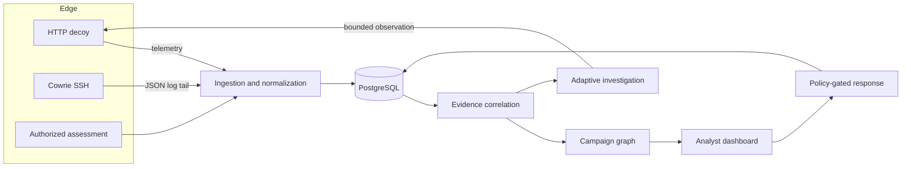

# ThreatPolish

<<<<<<< HEAD
Custom defensive honeypot platform designed for unauthorized interaction capture, attacker telemetry collection, event normalization, and behavioral logging.

---

## Architecture & Implementation Milestones

- **Phase 1: Foundation & Scaffolding**
  - FastAPI application structure, CORS configuration, health and liveness monitoring endpoints.
  - React + Vite dashboard frontend skeleton.
  - Safe Docker Compose configuration bound strictly to `127.0.0.1`.

- **Phase 2: Event Schema & Database Foundation**
  - Pydantic v2 Canonical Event Schema (`CanonicalEvent` v1.0) with UUID validation, strict UTC timezone enforcement, IP/port constraints, and credential exclusion.
  - SQLAlchemy 2.0 ORM models: `Event`, `SessionModel`, `Alert`, `DetectionRule`, `IngestionFailure`, and `alert_events`.
  - Alembic database migration management.

- **Phase 3: Simulated Decoys & Telemetry Ingestion (Current)**
  - **Reusable Telemetry Ingestion Pipeline (`TelemetryIngestionService`):**
    - Validates events against the canonical schema.
    - Normalizes timestamps to timezone-aware UTC.
    - Idempotently deduplicates event IDs.
    - Automatically manages attacker session correlations (`sessions` table).
    - Safely logs validation failures into `ingestion_failures` with sensitive credentials redacted.
  - **In-Process Simulated Decoys:**
    - **SSH Decoy Simulator (`SSHDecoySimulator`):** Simulates SSH authentication attempts, records submitted usernames and password lengths, returns harmless `Permission denied` responses, never opens a real socket, and never executes commands.
    - **REST API Decoy Simulator (`RESTDecoySimulator`):** Simulates reconnaissance trap endpoints (`/admin`, `/wp-admin`, `/.env`, etc.), strips authorization tokens, and returns mock 401/403/404 responses without exposing actual server environment or files.
    - **Database Decoy Simulator (`DatabaseDecoySimulator`):** Simulates database authentication and detects SQL injection signatures (`' OR '1'='1'`, `UNION SELECT`, `DROP TABLE`), returns mock PostgreSQL error codes (`28P01`, `42501`), and never connects to or executes against any real database.

---

## Defensive Security Guarantees

1. **No Real Network Listeners for Decoys:** In this phase, all decoys operate strictly as in-process Python simulators. No open ports or public interfaces are exposed.
2. **Strict Credential Exclusion:** Raw passwords, hashes, API keys, and authorization headers are never logged or persisted. The schema captures only `password_length` and `auth_outcome`.
3. **No Execution:** Shell commands and SQL statements submitted to simulated decoys are analyzed in-memory for signatures and immediately discarded.

---

## Running the Decoy Simulation Demo

To demonstrate the three simulated decoys and verify event ingestion in real time:

```powershell
cd backend
.\.venv\Scripts\python -m app.demo
```

---

## Running Tests

To run the complete backend test suite (93 tests covering schemas, models, migrations, ingestion pipeline, and decoy simulators):

```powershell
cd backend
.\.venv\Scripts\pytest -v --tb=short
```

To run only the Phase 3 simulator and ingestion tests:

```powershell
cd backend
.\.venv\Scripts\pytest -v tests/test_ingestion_service.py tests/test_decoys.py
```
=======
**Evidence-guided campaign correlation with uncertainty-aware adaptive deception.**

[](https://github.com/heyytrayamm/ThreatPolish/actions/workflows/ci.yml)


ThreatPolish is a self-hosted defensive platform. It ingests telemetry from
authorized decoys and assessments, correlates sessions across IP addresses using
explicit behavioural evidence, explains every relationship it proposes, and can
request additional observation through isolated decoy profiles when the evidence
is genuinely uncertain.

It does **not** identify attackers. It produces relationship hypotheses with
recorded evidence, confidence, contradictions and expiry, so an analyst can
decide what the evidence supports.

> **Status:** 1.0.0. The Docker/PostgreSQL deployment is verified end to end on a
> single node, including restart, backup/restore, database outage and live Cowrie
> ingestion. The evaluation uses synthetic telemetry; see its limitations before
> drawing operational conclusions.

## Dashboard


| Campaign evidence | Sign in |
| --- | --- |
|  |  |

The interface shows the evidence behind each hypothesis: severity and
confidence are separate, contradictions and missing evidence are visible, and
no view presents an IP address as an identity.

## Why this exists

Attribution tools usually start from an IP address. Attackers rotate addresses,
share infrastructure and reuse the same scanner. ThreatPolish starts from
behaviour instead:

- **Correlate across addresses, not by address.** Sessions are compared over six
  evidence families — behaviour, targeting, timing, identity, verified
  intelligence and toolchain.
- **Audit every link.** Each edge stores its components, contradictions, missing
  evidence, algorithm version and a human-readable explanation. A link needs a
  high-specificity anchor, not just a high score.
- **Treat ubiquitous artefacts as noise.** Tokens common across the analysed
  window are excluded, so sharing `root` or a stock SSH client proves nothing.
- **Observe only when it matters.** Ambiguous pairs can trigger a bounded decoy
  investigation that records before/after confidence and cannot invent evidence.
- **Act with control.** Response actions are policy-gated, approvable, expiring
  and reversible, with a full audit trail.

## Architecture



A modular monolith keeps the data model and audit trail consistent. The API
serves the React dashboard, the database is internal to the Compose network, and
only decoy ports face the outside.

## Capabilities

| Area | What is implemented |
| --- | --- |
| Telemetry | Versioned event contract, validation, normalization, deduplication, quarantine, retention, source health |
| Deception | HTTP/API decoy with real capture, Cowrie JSON adapter with idempotent tailing, database-backed decoy profiles |
| Correlation | Session features, corpus-relative evidence weighting, six families, contradictions, specificity anchors, graph, campaign candidates, analyst feedback |
| Adaptive investigation | Uncertainty-driven profile selection, bounded activation, before/after re-evaluation, honest outcome reporting |
| Risk | Separate severity, confidence and asset risk with a published formula and per-factor explanation |
| Web security | Explicit authorization scopes, SSRF guards, non-destructive checks, opt-in active probes, remediation guidance |
| Digital assets | Provider adapter with provenance and freshness, explainable asset risk, no wallet secrets accepted |
| Response | Policy thresholds, approval, expiry, rollback, emergency disable, audit trail |
| Operations | CLI, migrations, Docker/Compose, health checks, runbooks, evaluation harness |

## Quick start

### Docker Compose

Requirements: Docker with Compose v2, 2 GB RAM.

```bash
cp .env.example .env
# Set TP_JWT_SECRET, TP_DB_PASSWORD, TP_DB_URL and the bootstrap admin.
# Generate secrets with: python3 -c "import secrets;print(secrets.token_urlsafe(48))"

docker compose up --build -d
docker compose ps
curl -fsS http://127.0.0.1:8000/api/v1/health/ready
```

Open `http://127.0.0.1:8000/` and sign in with the bootstrap administrator. After
the first login, save the password, remove `TP_BOOTSTRAP_ADMIN_*` from `.env`,
and restart the app.

Optional Cowrie sensor:

```bash
docker compose --profile honeypot up -d cowrie
docker compose exec app python -m app.cli cowrie-tail \
  --path /var/log/cowrie/cowrie.json
```

The HTTP decoy runs as a separate process so it can sit on an isolated segment:

```bash
cd backend
python -m app.cli decoy --host 0.0.0.0 --port 8022
```

### Local development

Requirements: Python 3.12+, Node 20+.

```bash
python -m venv .venv && source .venv/bin/activate
pip install -r backend/requirements-dev.txt
npm --prefix frontend ci --no-audit --no-fund
cp .env.example .env

cd backend
python -m app.cli create-admin --email you@example.com
uvicorn app.main:app --host 127.0.0.1 --port 8000
```

For the dashboard with hot reload, run `npm --prefix frontend run dev` and open
`http://127.0.0.1:5173`; Vite proxies `/api` to the backend.

## Connecting a sensor

Create a revocable agent token (shown once):

```bash
cd backend
python -m app.cli create-token --name decoy-1 --role sensor
```

Send events with `X-Agent-Token: tp_...`. A single object, an array, or
`{"events": [...]}` up to 500 records is accepted:

```bash
curl -sX POST http://127.0.0.1:8000/api/v1/ingest/events \
  -H "X-Agent-Token: $TP_AGENT_TOKEN" \
  -H "Content-Type: application/json" \
  -d '{"schema_version":"1.0","occurred_at":"2026-01-01T00:00:00Z","source_module":"honeypot","event_type":"honeypot.ssh.login_failed","source_ip":"203.0.113.9","session_id":"sess-1","severity":"low","provenance":{"collector":"cowrie","source":"decoy-1","reliability":0.8,"synthetic":false},"features":{"username":"root","success":false,"client_version":"SSH-2.0-libssh_0.9.6"}}'
```

Use the namespaced event types documented in
[`docs/04-event-contract.md`](docs/04-event-contract.md); custom names are stored
but contribute no correlation features.

## Evaluation

```bash
cd backend
python scripts/evaluate.py
```

On 63 synthetic sessions and 1,953 pairs, the proposed method reached precision
1.00 / recall 0.78 (seed 7) and precision 1.00 / recall 0.56 (seed 2026) with no
false positives, against a rule baseline at precision 0.07 / recall 0.94 with a
27% false-positive rate. Campaign-level exact recovery was 8 of 12 and 4 of 12.
The hard subset, adaptive experiment, ablations and limitations are reported in
[`docs/research/evaluation-results.md`](docs/research/evaluation-results.md).

These are synthetic results. Ground truth is scenario membership, not actor
identity, and the confidence index is not a calibrated probability.

## Security posture

- Bearer sessions are short-lived and bound to tab-scoped storage; agent tokens
  are hashed at rest and revocable.
- The dashboard is served with a strict Content-Security-Policy; API docs are
  excluded because they load their own assets.
- Production refuses example signing secrets and starts only with a real one.
- Assessment targets require an unexpired authorization scope and must resolve
  to public addresses; loopback is opt-in and disabled by default.
- Passwords captured by decoys are stored as truncated hashes, never plaintext.
- Every sensitive action is audited. Containment requires high confidence, an
  observed target and administrator approval, and has an expiry and rollback.

See [SECURITY.md](SECURITY.md) and [docs/03-threat-model.md](docs/03-threat-model.md).

## Repository map

```text
backend/app/api          HTTP surface and dependencies
backend/app/correlation  session features, scoring, graph and campaigns
backend/app/deception    decoy profiles, HTTP decoy, Cowrie adapter, adaptive loop
backend/app/websec       authorization scopes, SSRF guards, assessment checks
backend/app/response     policy, approvals, expiry and rollback
backend/app/telemetry    ingestion, normalization, repository
backend/app/risk         severity, confidence and asset risk
backend/tests            unit, integration and end-to-end tests
frontend                 React/TypeScript analyst dashboard
docs                     audit, method, architecture, threat model and runbooks
docs/assets              dashboard screenshots used by the README
deploy                   Cowrie configuration
```

## Documentation

| Document | Purpose |
| --- | --- |
| [Repository audit](docs/00-repository-audit.md) | Starting state, environment and build decisions |
| [Novelty review](docs/01-novelty-review.md) | Prior work, gap and falsifiable hypothesis |
| [Architecture](docs/02-architecture.md) | Components, data flow, capacity and failure behaviour |
| [Threat model](docs/03-threat-model.md) | Assets, adversaries, controls and residual risk |
| [Event contract](docs/04-event-contract.md) | Versioned schema and normalization rules |
| [API reference](docs/05-api.md) | Endpoints, roles, examples and errors |
| [Testing and evaluation](docs/06-testing-and-evaluation.md) | Suite, benchmark, container verification and gaps |
| [Operations](docs/07-operations.md) | Deployment, configuration, backup, recovery and runbooks |
| [Implementation status](docs/08-implementation-status.md) | Stage-by-stage delivery evidence |

## Verification

```bash
cd backend
ruff check app tests scripts --select F,E9
python -m pytest -q          # 66 tests
cd ../frontend
npm run build
```

CI runs the same checks on every push and pull request, plus the full suite
against PostgreSQL 16 and a container image build. The PostgreSQL job uses
`TP_TEST_DB_URL` and resets the schema for each test, so engine-specific query
behaviour is covered rather than assumed.

## License

Proprietary and confidential. Copyright (c) 2026 ThreatPolish Team. All rights
reserved. No use, copying, modification or distribution is permitted without
prior written permission from the Team. See [LICENSE](LICENSE). Third-party
dependencies remain under their own licenses.

The software includes deception and assessment capability and must be used only
against systems for which the operator has explicit authorization.
>>>>>>> origin/main
