<p align="center">
  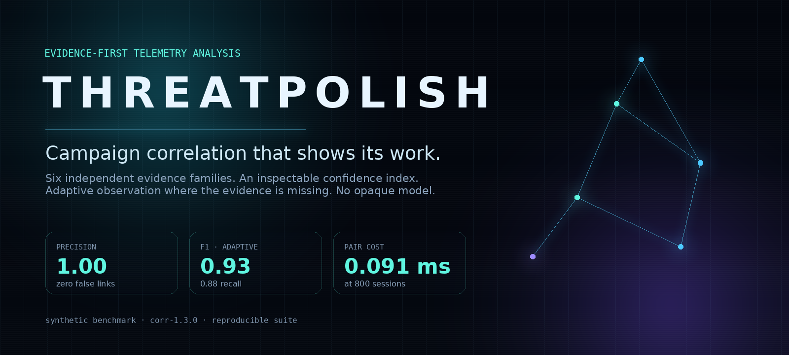
</p>

<h1 align="center">ThreatPolish</h1>

<p align="center">
  <strong>Campaign correlation that shows its work.</strong><br />
  Evidence-guided session correlation with uncertainty-aware adaptive deception.
</p>

<p align="center">
  <a href="https://github.com/heyytrayamm/ThreatPolish/actions/workflows/ci.yml"></a>
  
  
  
  
  
</p>

> **Status — 1.0.5.** Self-hosted. The Docker/PostgreSQL path is verified end to
> end, including restart, backup/restore, database outage and live Cowrie
> ingestion. Benchmark results use synthetic telemetry; read the
> [limits](#limits) before drawing operational conclusions.

ThreatPolish ingests telemetry from authorized decoys and assessments, correlates
sessions across IP addresses using explicit behavioural evidence, explains every
relationship it proposes, and can request additional observation through isolated
decoy profiles when the evidence is genuinely uncertain.

It does **not** identify attackers. It produces relationship hypotheses with
recorded evidence, confidence, contradictions and expiry, so an analyst can
decide what the evidence supports.

---

## The problem, in one page

An attacker changes address between two sessions. A rule engine sees two
unrelated hosts; a lookup table sees nothing at all. Yet the same actor is often
still there — in the command sequence, the client banner, the target order, the
cadence. The information that survives infrastructure rotation is behavioural,
and it is thin, uneven and frequently missing.

This project asks a narrow, falsifiable question:

> **Can a transparent, evidence-weighted similarity model recover campaign
> membership at zero false-positive cost, and can it name the evidence that would
> make its uncertain decisions decidable?**

Four commitments follow from it.

| Commitment | Consequence in the system |
| --- | --- |
| **Attribution is a graph problem, not a lookup.** | Sessions are nodes; every link carries a component table, not just a score. |
| **Specificity is the currency of evidence.** | Tokens common across the analysis window carry near-zero weight; rare sequences and verified artefacts carry the rest. |
| **Uncertainty should trigger observation, not assertion.** | Ambiguous pairs can activate a bounded decoy profile and be re-scored after new telemetry. Evidence can be added; it cannot be invented. |
| **Inference and action are separate privileges.** | A high score is not permission to block. Containment is policy-gated, approved, expiring and reversible. |

## Architecture

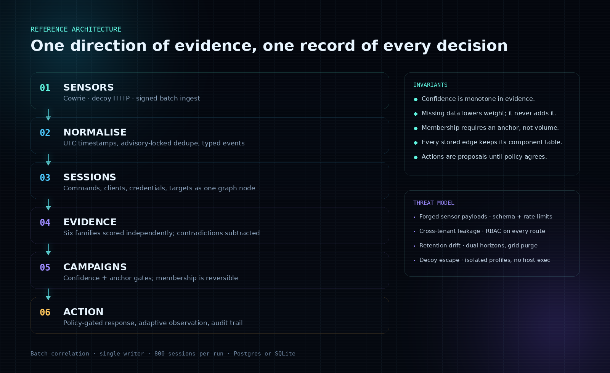

| Stage | What happens | Artefact |
| --- | --- | --- |
| **01 · Observe** | Decoys and assessments emit versioned events over one contract | Event batch |
| **02 · Normalize** | Validate, clean, deduplicate and quarantine rejected records | Evidence store |
| **03 · Correlate** | Build sessions, score six evidence families, require specificity anchors, subtract contradictions | Scored graph |
| **04 · Investigate** | Ambiguous pairs request bounded observation; before/after confidence is recorded | Investigation record |
| **05 · Decide** | Analysts inspect components, missing evidence and campaign context | Campaign candidate |
| **06 · Act** | Policy decides what is permitted; humans approve containment; every rule expires | Audited response |
| **07 · Learn** | Analyst feedback marks relationships supported or rejected for the next review | Calibration signal |

The full component and failure-behaviour description is in
[docs/02-architecture.md](docs/02-architecture.md).

## The confidence model

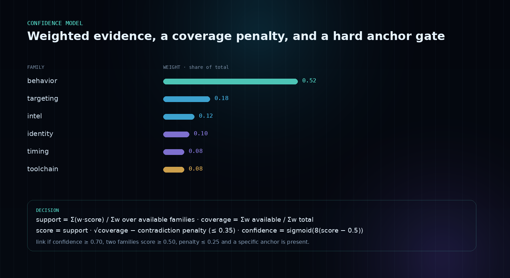

Six families are scored independently — behaviour, targeting, intel, identity,
timing and toolchain. Family scores are weighted, normalised over what was
actually observed, then penalised for missing coverage and for contradictions:

```text
support    = Σ(weight × score) / Σ(weight)      over available families
coverage   = Σ(weight available) / Σ(weight total)
score      = support × √coverage − contradiction_penalty   (penalty ≤ 0.35)
confidence = sigmoid(8 × (score − 0.5))
```

A pair is **linked** only when all of the following hold: confidence ≥ 0.70, at
least two families score ≥ 0.50, the contradiction penalty is ≤ 0.25, the pair is
not a shared-IP/disjoint-behaviour contradiction, **and** at least one
high-specificity anchor is present. Otherwise the evidence is retained as a
hypothesis instead of being thrown away.

Three invariants make the output auditable:

1. Confidence is monotone in evidence. Missing data lowers weight; it never adds it.
2. Every stored relationship keeps the component table that produced it, including
   unavailable components and their weight.
3. A decision can be demoted without erasing why it was once made.

## The analyst workspace

Campaign candidates, the live evidence graph and the correlated-session counts.
Severity and confidence are shown separately; no view presents an IP address as
an identity.

The console is the default theme. `Daylight` in the ribbon switches to a
bright-room variant of the same layout — the same panels, rail and gauge strip
with dark ink on cool paper — and the choice is remembered for the next visit.
Until that switch is made the host decides, and goes on deciding: a console left
open follows the operating system between light and dark as it changes. Both
variants are drawn from one token set: no component knows which theme is active.

| Console (default) | Daylight |
| --- | --- |
|  | 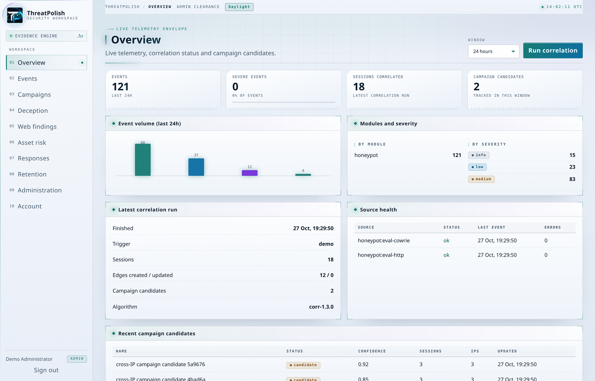 |

<p align="center">
  
</p>

### Evidence matrix — a campaign you can read at a glance

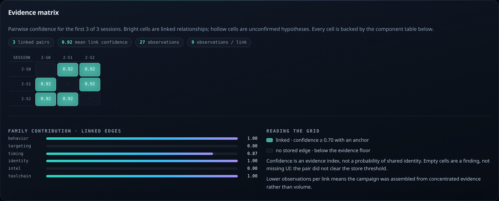

Every campaign detail now renders its own relationship topology: an
N×N confidence grid where each cell is a stored edge and its confidence. The
matrix is not decoration — it makes fragmentation, missing links and
over-connected members visible before an analyst opens a single edge. Family
contribution bars beside it show *which kind* of evidence is holding the campaign
together. Empty cells are a finding: the pair did not clear the store threshold.

### Evidence acquisition plan — the inverse of a score

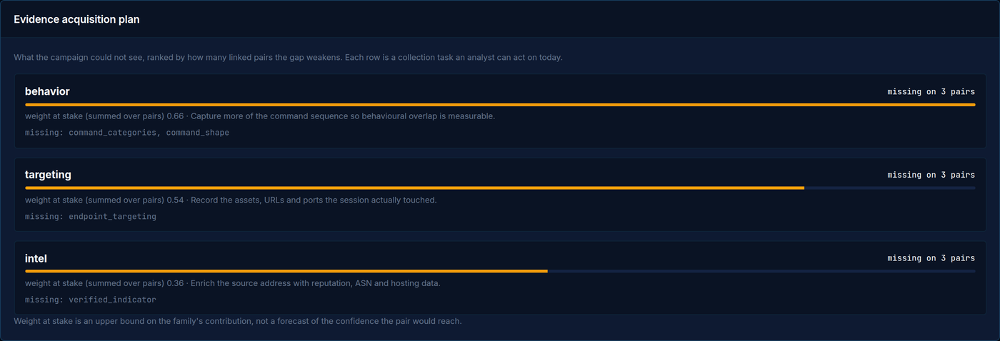

Most tools answer *what is known*. This panel answers **what is missing and worth
collecting**. For each evidence family it aggregates the components that were
unavailable across the campaign's active edges, ranks families by how many pairs
the gap weakens, and reports the weight that new telemetry could recover, with a
concrete collection instruction ("record the assets the session touched", "retain
the SSH client banner"). Weight at stake is labelled as an upper bound, because an
observation that exists can still score low for a specific pair.

The same response adds **observation efficiency**: events observed, observations
per confirmed link, and observations per session. Lower is better — it measures
how concentrated the evidence behind a campaign actually is, and it lets two
campaigns of equal confidence be compared by how cheaply they were earned.

### Kill-chain coverage — progression without assertion

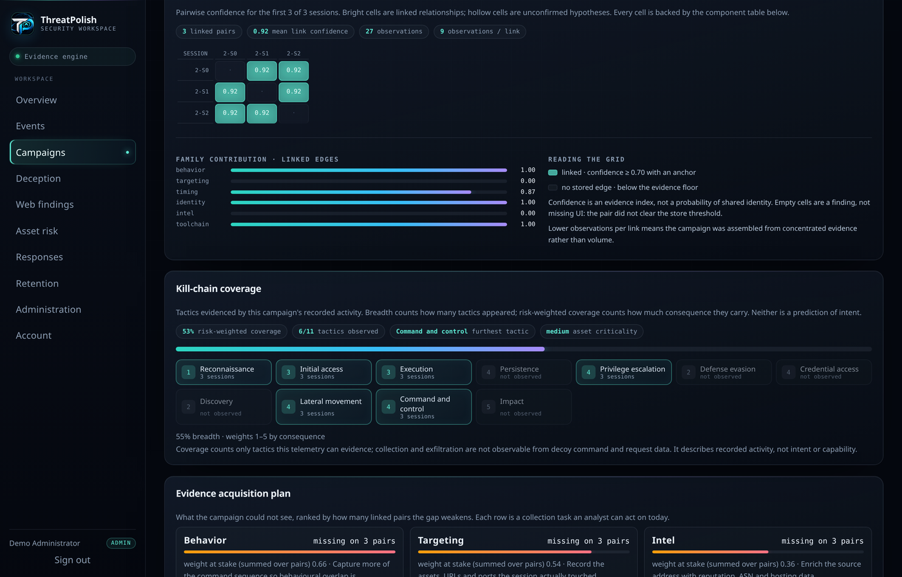

Normalized command categories and authentication activity are mapped onto the
eleven tactics this telemetry can actually evidence. Each tactic carries a coarse
1–5 consequence weight, so the view reports two different things:

- **Breadth** — how many tactics appeared at all.
- **Risk-weighted coverage** — how much consequence those tactics carry.

A campaign that only probes a decoy and one that reaches credential access are no
longer the same shade of "suspicious". The furthest observed tactic breaks ties by
progression, so reaching command and control is reported as further than privilege
escalation even though both weigh the same. Collection and exfiltration are absent
from the model rather than inferred: this telemetry cannot observe them.

<details>
<summary><strong>More views: adaptive deception and the event stream</strong></summary>

| Adaptive observation | Event stream |
| --- | --- |
| 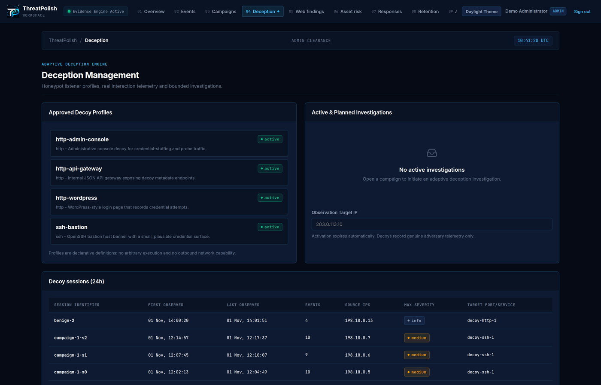 | 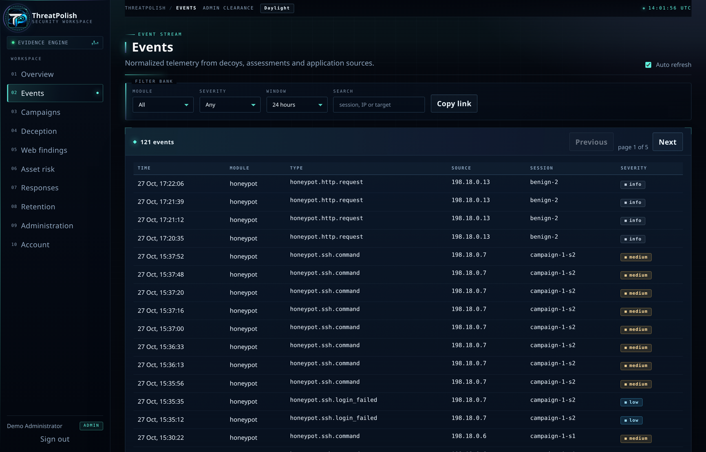 |

The Deception view shows which sources were placed under bounded observation, the
profile chosen, and the before/after confidence of the pairs that motivated it.
The event stream keeps module, severity, source and search filters in the URL, so
an analyst can hand a colleague the exact view they are looking at.

</details>

## Results

All figures below are generated from the recorded runs in
[`docs/research/evaluation-results.json`](docs/research/evaluation-results.json) by
`backend/scripts/render_assets.py`. Benchmark: 63 labelled synthetic sessions,
1,953 pairs (38 positive), algorithm `corr-1.3.0`, thresholds fixed before
measurement.

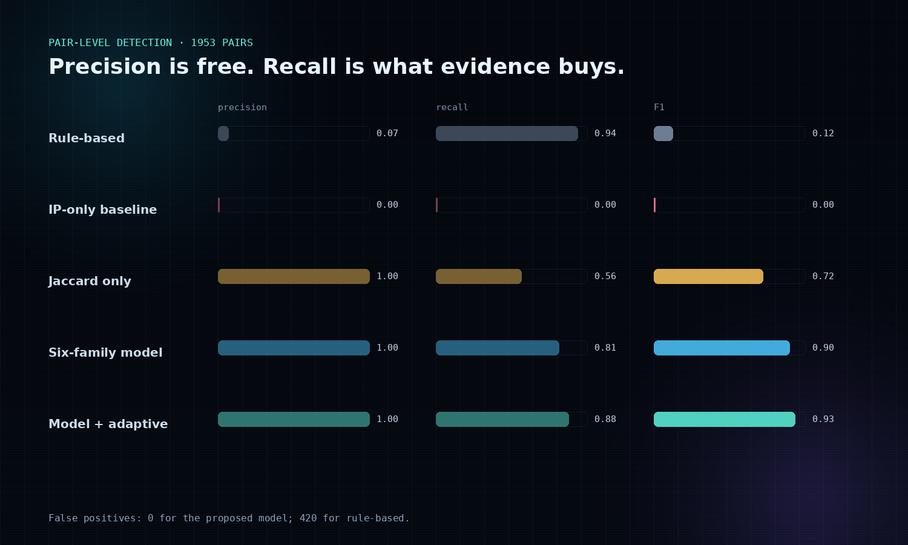

| Method | P · seed 7 | R · seed 7 | F1 · seed 7 | P · seed 2026 | R · seed 2026 | F1 · seed 2026 | FP · 7 / 2026 |
| --- | ---: | ---: | ---: | ---: | ---: | ---: | ---: |
| IP-only grouping | 0.000 | 0.000 | 0.000 | 0.000 | 0.000 | 0.000 | 4 / 4 |
| Rule-based matching | 0.066 | 0.938 | 0.123 | 0.067 | 0.938 | 0.124 | 424 / 420 |
| Jaccard-only ablation | 1.000 | 0.812 | 0.897 | 1.000 | 0.562 | 0.720 | 0 / 0 |
| **Six-family model** | **1.000** | **0.906** | **0.951** | **1.000** | **0.812** | **0.897** | **0 / 0** |
| **Model + adaptive observation** | **1.000** | **0.938** | **0.968** | **1.000** | **0.875** | **0.933** | **0 / 0** |

The operating point is deliberately conservative: it prefers a missed link over a
false accusation. The rule baseline finds slightly more true pairs and is unusable
at scale because more than a quarter of its positive decisions are wrong.

### Ablation: which evidence actually carries the signal

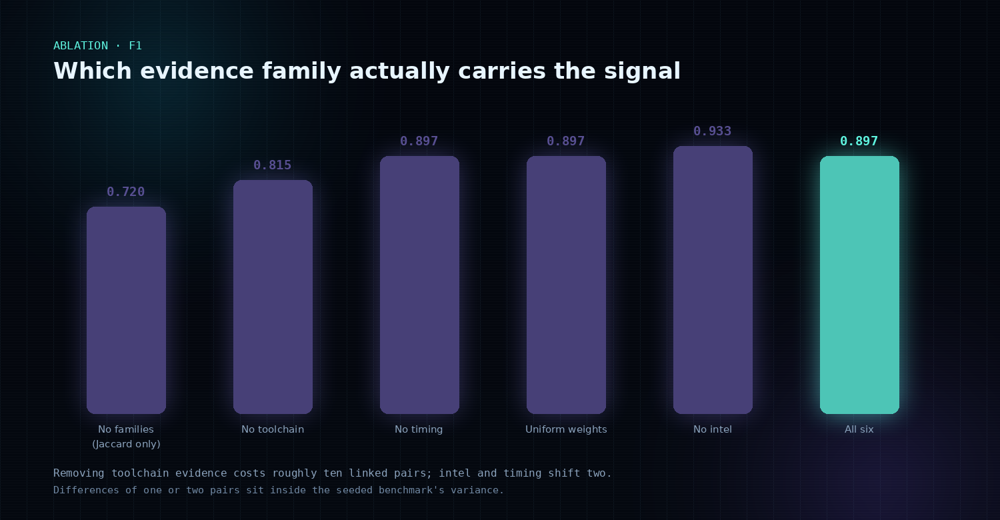

| Variant | F1 · seed 7 | F1 · seed 2026 | Reading |
| --- | ---: | ---: | --- |
| Jaccard sequence comparison only | 0.897 | 0.720 | Overlap comparison is the largest single gain |
| Without toolchain family | 0.897 | 0.815 | Client/banner evidence matters most |
| Without timing family | 0.915 | 0.897 | Cadence is a real but secondary signal |
| Uniform family weights | 0.933 | 0.897 | Corpus-relative weighting adds ~0.02–0.05 |
| Without threat-intel family | 0.968 | 0.933 | Scores *higher*; reported, not hidden |
| **All six families** | **0.951** | **0.897** | Shipped operating point |
| **Plus adaptive observation** | **0.968** | **0.933** | 1–2 links gained, none lost |

The intel ablation is the honest anomaly: on this benchmark the family is
redundant with behaviour. It is kept because it is the only family that can link
sessions with no shared behaviour, and tuning it against this dataset would be
fitting to the test. The differences above are one or two pairs and sit inside
the seeded benchmark's variance.

### Campaign level and time to detection

| Metric | Seed 7 | Seed 2026 | Volume run |
| --- | ---: | ---: | ---: |
| Sessions / pairs | 63 / 1,953 | 63 / 1,953 | 165 / 13,530 |
| Exact campaign recovery | 10 / 12 | 8 / 12 | 37 / 42 |
| Predicted clusters | 10 | 10 | 40 |
| Cluster purity | 1.000 | 1.000 | 1.000 |
| Median time to detection | 541.5 s | 614.0 s | — |
| Groups that produced a link | 10 / 12 | 10 / 12 | — |

On the 165-session volume run the model holds **P 1.000 / R 0.918 / F1 0.957**
(0 false positives) while the rule baseline emits **7,087 false positives** for
P 0.017. The generic-scanner hard subset is reported separately at P 0.400 /
R 1.000 for every method: its labels are not recoverable from the telemetry, so
including it would only test the dataset.

Adaptive observation gained 1 correct link on seed 7, 2 on seed 2026 and 2 on the
volume run, and lost none. That is too small a sample to claim a benefit; the
mechanism is reported as working, not as proven.

### Cost and capacity

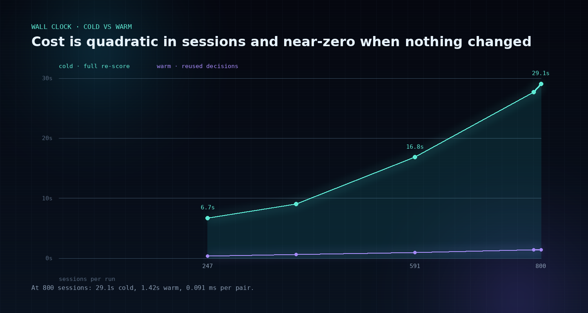

| Target sessions | Actual | Pairs | Stored edges | Cold wall | Warm wall | Per pair |
| --- | ---: | ---: | ---: | ---: | ---: | ---: |
| 250 | 247 | 30,381 | 3,655 | 6.71 s | 0.33 s | 0.221 ms |
| 400 | 394 | 77,421 | 8,000 | 9.02 s | 0.62 s | 0.116 ms |
| 600 | 591 | 174,345 | 8,000 | 16.83 s | 0.97 s | 0.097 ms |
| 800 | 788 | 310,078 | 8,000 | 27.69 s | 1.40 s | 0.089 ms |
| 1,000 (cap raised) | 800 | 319,600 | 8,000 | 29.06 s | 1.42 s | 0.091 ms |

Pairs are quadratic in sessions; warm runs reuse stored decisions and cost almost
nothing. The 800-session cap is the largest window at which the 8,000-edge budget
retains every linked pair — it is set by that measurement, not by intuition.
Full tables: [`docs/research/evaluation-results.md`](docs/research/evaluation-results.md)
and [`docs/research/correlation-runtime.md`](docs/research/correlation-runtime.md).

The evidence views are measured too. `get_campaign` assembles the plan, ratios and
tactic coverage from the rows the campaign already reads; it does not re-score.

| Dataset | Sessions | Campaigns | Detail mean | p95 | JSON payload | Plan families (median) | Tactic coverage (median) |
| --- | ---: | ---: | ---: | ---: | ---: | ---: | ---: |
| Evaluation volume (seed 99) | 165 | 41 | 0.66 ms | 1.01 ms | 28.2 KiB | 2 | 0.53 |
| 400-session run | 394 | 81 | 2.99 ms | 3.58 ms | 76.4 KiB | 2 | 0.53 |

One campaign in the 400-session run took 46 ms, so a single large campaign can
dominate a page load; cost tracks campaign size and payload, not the number of
campaigns. Source: [`docs/research/evidence-views.md`](docs/research/evidence-views.md).

Ingestion was measured against a real API with four worker processes on
PostgreSQL 16, six clients writing while one correlation run scanned 165 sessions
and 13,530 pairs (6.4 s). Two runs on a reset schema:

| Condition | p50 | p95 | Worst request | Errors |
| --- | ---: | ---: | ---: | ---: |
| Idle | 10.5–12.5 ms | 13.4–18.7 ms | 43–134 ms | 0 |
| During correlation | 10.7–16.3 ms | 23.8–25.1 ms | 555–699 ms | 0 |

The median moves within run-to-run noise; the tail does not. Accepted events
reconciled exactly with the stored count in both runs. Source:
[`docs/research/write-contention.md`](docs/research/write-contention.md).

## Verification

| Check | Result |
| --- | --- |
| Backend suite · SQLite | **207 passed** in 112.8 s (eight of them drive Chrome end to end) |
| Backend suite · PostgreSQL 16 | **207 passed** in 307.3 s against a real service database (PostgreSQL 16.15) |
| Four API workers, six writers, PostgreSQL 16 | No write errors while correlation ran; accepted events reconciled exactly; p95 18.7 → 24.5 ms and the worst request 43 → 555 ms |
| Campaign evidence plan and observation metrics | Unit-tested against a seeded campaign; the same test runs on SQLite and PostgreSQL |
| Static analysis | Ruff clean on `app`, `tests` and `scripts`; `compileall` clean |
| Dependency audit | `pip-audit` and `npm audit --audit-level=high` report no known vulnerabilities |
| Dashboard build | TypeScript project build and Vite production build pass |
| Deep scan | Every API route exercised as each role and anonymously: no authorization disagreement, no 5xx; 23 SSRF payloads, none reached; every outbound call pointed at a hostile probe refused the redirect and stopped at the 1 MiB bound |
| Determinism | Every benchmark run is seeded and reproducible from its recorded seed; the dataset is anchored, so two runs agree exactly |

```bash
cd backend
ruff check app tests scripts
python -m pytest -q
TP_TEST_DB_URL=postgresql+psycopg://... python -m pytest -q
cd ../frontend
npm run build
```

CI repeats these on every push and pull request, including the full suite against
PostgreSQL, both dependency audits and a container image build.

## Quick start

### Docker Compose

Requirements: Docker with Compose v2 and 2 GB RAM.

```bash
cp .env.example .env
# Set TP_JWT_SECRET, TP_DB_PASSWORD, TP_DB_URL and the bootstrap administrator.
# Generate secrets with: python3 -c "import secrets;print(secrets.token_urlsafe(48))"

docker compose up --build -d
docker compose ps
curl -fsS http://127.0.0.1:8000/api/v1/health/ready
```

Open `http://127.0.0.1:8000/` and sign in with the bootstrap administrator. After
the first login, remove `TP_BOOTSTRAP_ADMIN_*` from `.env` and restart.

### Local development

```bash
python -m venv .venv && source .venv/bin/activate
pip install -r backend/requirements-dev.txt
npm --prefix frontend ci --no-audit --no-fund
cp .env.example .env             # Docker Compose reads this file; the API does not

npm --prefix frontend run build  # the API serves frontend/dist, so build it first
cd backend
python -m app.cli create-admin --email you@example.com   # prompts for a password
python -m app.cli seed-demo      # demo login, telemetry, campaigns and retention history
uvicorn app.main:app --host 127.0.0.1 --port 8000
```

Open `http://127.0.0.1:8000/` and sign in. For front-end work,
`npm --prefix frontend run dev` serves the dashboard on `127.0.0.1:5173` and
proxies `/api` to `127.0.0.1:8000`, so keep the API on that port. Build the
bundle before starting the API: the mount is decided at startup, and until it is
built the root answers with a `dashboard_not_built` note explaining what to run
rather than a bare 404.

The API reads environment variables directly — the local process does not parse
`.env`, only Compose does — so export anything you change for a local run
(`set -a; . ./.env; set +a`). `create-admin` and `create-user` prompt for a
password; pass `--password` where there is no terminal, and use a generated one
rather than shipping a literal in a script.

For a one-command review after `make install`, run `make demo`. It seeds the demo
data, builds the dashboard and serves it on `http://127.0.0.1:8000`; the generated
password is printed once. Demo seeding refuses to run when `TP_ENV=production`.

Reproduce the artwork in this README after a fresh evaluation:

```bash
cd backend
python scripts/evaluate.py                      # writes docs/research/*
python scripts/render_assets.py
# The console pass writes the names above; the daylight pass adds `-daylight`
# and captures the overview only.
python scripts/capture_screenshots.py --email demo@threatpolish.local \
    --password '<demo password>' --themes console,daylight
```

### Connecting a sensor

```bash
cd backend
python -m app.cli create-token --name decoy-1 --role sensor
```

Send events with `X-Agent-Token: tp_...`. A single object, an array, or
`{"events": [...]}` up to 500 records is accepted. Custom event types are stored
but contribute no correlation features; use the namespaced types in
[the event contract](docs/04-event-contract.md).

The HTTP decoy is a separate process so it can sit on an isolated segment:

```bash
python -m app.cli decoy --host 0.0.0.0 --port 8022
```

## Security posture

- Bearer sessions are short-lived and tab-scoped; agent tokens are hashed at rest
  and revocable.
- The dashboard is served with a strict Content-Security-Policy; API docs are
  excluded because they load their own assets.
- Production refuses example signing secrets and starts only with a real one.
- Assessment targets require an unexpired authorization scope, must resolve to
  public addresses, and every redirect is re-checked. Response bodies are capped.
- Decoy-captured passwords are stored as truncated hashes, never plaintext.
- Every sensitive action is audited. Containment requires high confidence, an
  observed target and administrator approval, and has an expiry and rollback.

See [SECURITY.md](SECURITY.md) and [the threat model](docs/03-threat-model.md).

## Repository map

```text
backend/app/api          HTTP surface and dependencies
backend/app/correlation  session features, scoring, graph, campaigns, evidence plan
backend/app/deception    profiles, HTTP decoy, Cowrie adapter, adaptive loop
backend/app/websec       authorization scopes, SSRF guards, assessment checks
backend/app/response     policy, approvals, expiry and rollback
backend/app/telemetry    ingestion, normalization, repository
backend/app/risk         severity, confidence and asset risk
backend/scripts          evaluation, benchmark, asset and screenshot generation
backend/tests            unit, integration and end-to-end tests
frontend                 React/TypeScript analyst workspace
docs                     architecture, method, threat model, runbooks
docs/assets              generated figures and dashboard screenshots
deploy                   Cowrie configuration
```

## Documentation

| Document | Purpose |
| --- | --- |
| [Repository audit](docs/00-repository-audit.md) | Starting state, environment and build decisions |
| [Novelty review](docs/01-novelty-review.md) | Prior work, gap and falsifiable hypothesis |
| [Architecture](docs/02-architecture.md) | Components, data flow, capacity and failure behaviour |
| [Threat model](docs/03-threat-model.md) | Assets, adversaries, controls and residual risk |
| [Event contract](docs/04-event-contract.md) | Versioned schema and normalization rules |
| [API reference](docs/05-api.md) | Endpoints, roles, examples and errors |
| [Testing and evaluation](docs/06-testing-and-evaluation.md) | Suite, benchmark, deployment verification and gaps |
| [Operations](docs/07-operations.md) | Deployment, configuration, backup, recovery and runbooks |
| [Implementation status](docs/08-implementation-status.md) | Stage-by-stage delivery evidence |

## Limits

These numbers come from synthetic sessions written for this project, not public
attack data. Ground truth is scenario membership, not actor identity. The
confidence index is monotone but has not been probability-calibrated. No
train/test split is reported because the method performs no learning. Adaptive
benefit is measured by simulation; production adaptation records real decoy
traffic and cannot manufacture evidence. The system makes no claim of actor
identification and is not a substitute for incident-response judgement.

## License

Proprietary and confidential. Copyright (c) 2026 ThreatPolish Team. All rights
reserved. No use, copying, modification or distribution is permitted without
prior written permission from the Team. See [LICENSE](LICENSE). Third-party
dependencies remain under their own licenses.

The software includes deception and assessment capability and must be used only
against systems for which the operator has explicit authorization.
