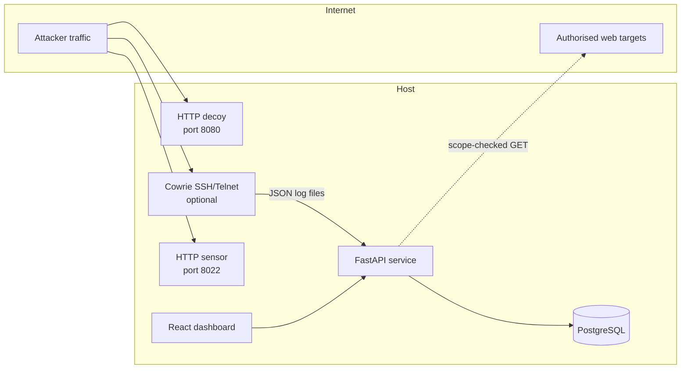
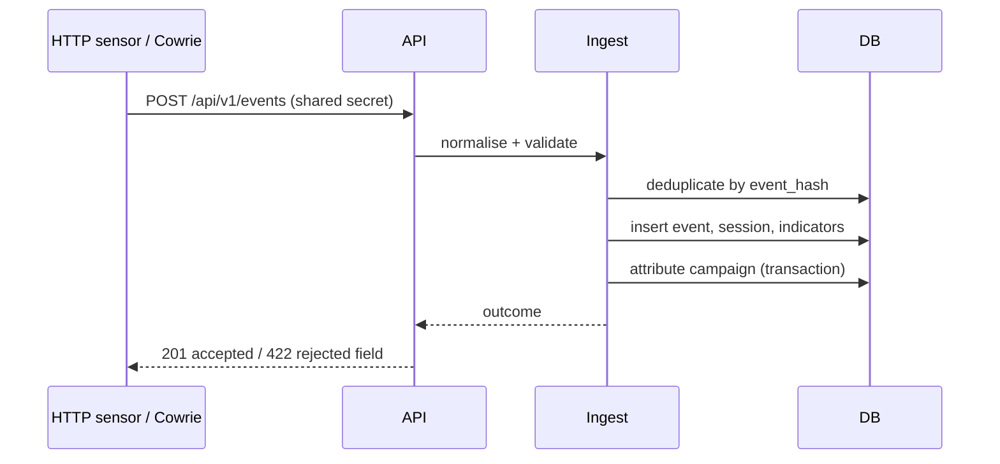
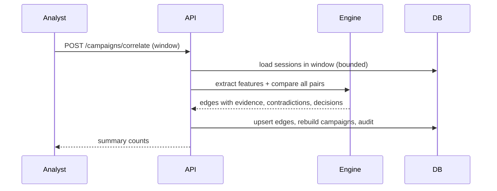

# Architecture

## Deployment shape

A modular monolith, one PostgreSQL database, a React single-page dashboard, and
decoy listeners that are network-reachable by attackers.

Ports: 8000 API (and the built dashboard), 8022 HTTP decoy
(`TP_DECOY_PORT`), 2222 Cowrie (optional Compose profile), 5173 dev dashboard,
5432 database (internal only). The Compose stack runs `db`, `app` and an
optional `cowrie` sensor; the HTTP decoy is a separate process started with the
CLI.

## Runtime components

| Component | Location | Responsibility |
| --- | --- | --- |
| Event contract | `app/schemas/event.py` | Validation, field bounds, canonicalisation |
| Ingestion | `app/services/ingestion.py` | Normalise, hash, deduplicate, persist, attribute |
| Telemetry adapters | `app/telemetry/` | HTTP sensor, Cowrie JSON, web findings, decoy events |
| Correlation | `app/correlation/` | Session features, family scoring, graph edges, campaigns |
| Risk | `app/risk/scoring.py` | Severity, asset risk, journey escalation |
| Deception | `app/deception/` | Decoy profiles, uncertainty-directed investigation |
| Web assessment | `app/websec/` | Scope, SSRF guards, non-destructive checks |
| Digital assets | `app/cryptointel/` | Quotes, signals, asset exposure |
| Response | `app/response/` | Policy decisions, approvals, expiry, rollback |
| Auth/RBAC | `app/auth/` | Password hashing, HS256 tokens, roles, audit |
| API | `app/api/` | Versioned JSON endpoints |
| Dashboard | `frontend/` | Analyst-facing views |

## Request flow: telemetry ingestion

Deduplication uses a SHA-256 over stable fields, so replaying a sensor buffer is
safe and idempotent. A malformed record is rejected as a whole; it is never
stored partially. Ingestion is per-record, and each record is committed with its
attribution so a later failure cannot leave an unattributed event.

## Request flow: correlation

Correlation is deterministic given the same window, algorithm version and seed.
It is bounded to the 400 most recent sessions (`MAX_SESSIONS_PER_RUN`) so an
analyst cannot trigger an unbounded quadratic computation; truncation is
reported in the run summary.

## Data model

`events` — normalised observation, unique `event_hash`.
`sessions` — per (source, actor, window) aggregate with JSON feature document.
`indicators` — first/last seen observation of an indicator.
`correlation_edges` — pair of sessions, score/confidence/decision, evidence JSON.
`campaigns` — cluster of sessions with summary and risk.
`investigations` — adaptive observation record with passive/observed values.
`web_findings` — scope-limited assessment results.
`responses` — proposed action, policy decision, approval, expiry, rollback.
`users`, `audit_log` — identity and accountability.
`crypto_assets`, `crypto_quotes` — cached asset data.

JSON columns are used only for evidence documents that are written and read as
a whole; anything queried or constrained is a typed column.

## Security boundaries

- The API is split into public (`/health`, `/auth/login`), sensor (shared
  secret), and analyst (bearer token + RBAC) surfaces.
- Decoy listeners never share an event loop or database session with the API;
  they write to the ingestion API or log files.
- Web assessment runs through a single scope gate and a single SSRF guard.
- The dashboard is a static build; the token lives in `sessionStorage`, is
  cleared on logout, and the CSP forbids inline script and external origins.

## Failure behaviour

| Failure | Behaviour |
| --- | --- |
| Database unavailable | API returns 503; no partial writes |
| Sensor token invalid or revoked | 401, nothing stored |
| Correlation window too large | The 400 most recent sessions are used; truncation is reported in the run summary |
| Web target out of scope | 403 before any connection |
| Web target private address | 403 unless local test explicitly enabled |
| Decoy request body large | Truncated at the configured bound |
| Response without approval | Blocked at execution, state `pending_approval` |
| Rollback of expired action | Rejected by state machine, 409 |

## Capacity

Correlation is quadratic in the number of sessions: the 400-session cap implies
79,800 pairs. The evaluation's 165-session volume run (13,530 pairs) took 18.7 s
and peaked at 112 MB, so a full capped run takes roughly a minute on one core.
The cap keeps a request bounded. Additional throughput would come from
restricting pairs by shared low-specificity keys, which is the next step if the
cap becomes restrictive.
