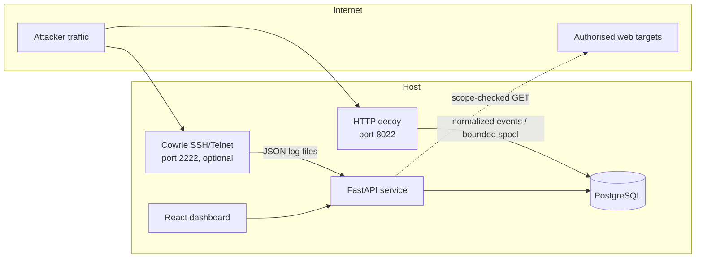
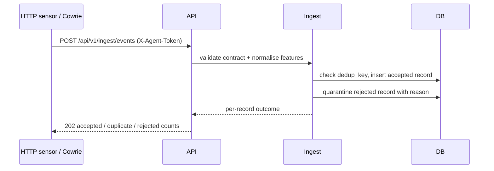
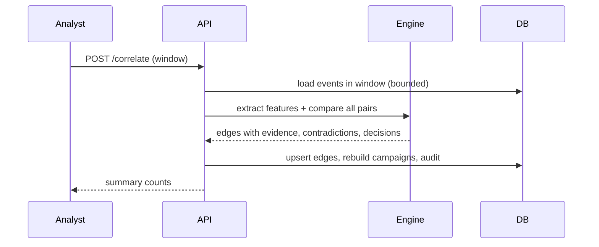

# Architecture

## Deployment shape

A modular monolith, one PostgreSQL database, a React single-page dashboard, and
decoy listeners that are network-reachable by attackers.

Ports: 8000 API (and the built dashboard), 8022 HTTP decoy
(`TP_DECOY_PORT`), 2222 Cowrie (optional Compose profile), 5173 dev dashboard,
5432 database (internal only). The Compose stack runs `db`, `app` and an
optional `cowrie` sensor; the HTTP decoy is a separate process started with the
CLI.

## Runtime components

| Component | Location | Responsibility |
| --- | --- | --- |
| Event contract | `app/schemas/event.py` | Validation, field bounds, canonicalisation |
| Ingestion | `app/telemetry/ingest.py` | Validate, normalise, deduplicate, persist, quarantine |
| Telemetry adapters | `app/telemetry/` | HTTP sensor, Cowrie JSON, web findings, decoy events |
| Correlation | `app/correlation/` | Session features, family scoring, graph edges, campaigns |
| Risk | `app/risk/scoring.py` | Severity, asset risk, journey escalation |
| Deception | `app/deception/` | Decoy profiles, uncertainty-directed investigation |
| Web assessment | `app/websec/` | Scope, SSRF guards, non-destructive checks |
| Digital assets | `app/cryptointel/` | Quotes, signals, asset exposure |
| Response | `app/response/` | Policy decisions, approvals, expiry, rollback |
| Auth/RBAC | `app/auth/` | Password hashing, HS256 tokens, roles, audit |
| API | `app/api/` | Versioned JSON endpoints |
| Dashboard | `frontend/` | Analyst-facing views |

## Request flow: telemetry ingestion

Deduplication uses a SHA-256 over the stable event fields, so replaying a sensor
buffer is safe and idempotent. A malformed record is rejected as a whole and
written to `event_quarantine`; it is never stored partially. Correlation is a
separate analyst-triggered step, so ingestion never blocks on graph work.

## Request flow: correlation

Correlation is deterministic for a fixed window, corpus and algorithm version.
It is bounded to the 800 most recent sessions (`MAX_SESSIONS_PER_RUN`) so an
analyst cannot trigger an unbounded quadratic computation; truncation is
reported in the run summary. The event load is capped at 50,000 rows and keeps
the newest events when that cap applies, so a busy window cannot silently
correlate only its oldest prefix; `events_truncated` reports the cap. Scored pairs are streamed through a heap of at
most `MAX_EDGES_PER_RUN` results instead of being retained, so peak memory stays
bounded as the window grows; the run reports how many pairs and how many links
the edge cap removed.

Campaign identity is separate from membership. A new component inherits an
existing campaign when at least half of its membership survives (Jaccard
overlap), matched one-to-one so a split cannot hand one identity to two
components; added and removed sessions are recorded in `membership_history`.
When a component absorbs two campaigns, feedback and response references move
to the survivor, open investigations on the absorbed row are marked
`superseded`, a single analyst decision is carried forward, and conflicting
decisions become `uncertain`. A campaign that loses its links is archived when
an analyst reviewed it or an investigation or response refers to it, and
deleted only when it is untouched automation. Archived rows stay readable and
are excluded from the default listing.

## Data model

`events` — normalised observation, unique `dedup_key`.
`graph_nodes` — sessions, IPs, assets, indicators and campaigns.
`graph_edges` — observed relationships and scored session pairs, with evidence,
contradictions, status and expiry.
`campaigns` — linked session clusters with summary and confidence.
`correlation_runs` — window, algorithm version and run metrics.
`investigations` — adaptive record including the persisted activation IP and
expiry, so the API and the separate decoy process agree.
`decoy_profiles`, `source_health` — allowed profiles and collector freshness.
`scans`, `findings`, `watch_scopes` — scope-limited assessment results.
`responses` — proposed action, policy decision, approval, expiry, rollback.
`crypto_snapshots`, `crypto_risk` — observed market facts and inferred scores.
`users`, `agent_tokens`, `audit_log`, `feedback` — identity and accountability.

JSON documents are stored as text only where they are written and read as a
whole; anything queried or constrained is a typed column.

## Adaptive activation

`POST /investigations/{id}/activate` writes the observation source IP and an
expiry onto the investigation row. The HTTP decoy is a separate process and
loads that row for each request, so an activation made through the API reaches
the listener without shared memory. Evaluation marks the investigation
`evaluated` and clears the expiry. Activations past their TTL are marked
`expired` on the next read or write, release their subject for a new
investigation and stop overriding the decoy profile. At most one investigation
is open per subject: partial unique indexes cover the `planned` and `active`
rows, so the limit holds even when two requests are planned at the same moment.

## Security boundaries

- The API is split into public (`/api/v1/health`, `/api/v1/health/ready`,
  `/api/v1/auth/login`), sensor (`X-Agent-Token`, hashed and revocable), and
  analyst (bearer token + RBAC) surfaces.
- Bearer tokens carry a per-account session version that is checked on every
  request. Changing a password increments the version, which revokes all
  tokens issued earlier; the caller receives a replacement token so the
  session performing the change continues without a re-login. An administrator
  can increment the same version through
  `POST /auth/users/{id}/revoke-sessions` when a token is suspected stolen,
  leaving the password unchanged.
- Decoy listeners share the database but not an event loop or request context
  with the API. The HTTP decoy writes events directly and spools to disk if the
  pipeline is unavailable; Cowrie logs are tailed with a persisted offset.
- Web assessment runs through a single scope gate and SSRF guard, including on
  every redirect.
- The dashboard is a static build; the token lives in `sessionStorage`, is
  cleared on logout, and the CSP forbids inline script and external origins.
- Sign-ins, password changes and administrative revocations are recorded in the
  audit trail with the client address, the user agent and the session version in
  force. The account's session history is derived from those records rather than
  from per-request logging, so an analyst can see where an account was used
  without the platform keeping a browsing record of every API call. Each token
  carries its own identifier, and signing out one device adds that identifier to
  `revoked_sessions`; the entry is dropped once the token would have expired, so
  a single device can be ended without touching the account's other sessions.
- A sign-in from a different network while an earlier session is still live is
  flagged as `auth.signin.anomaly` on the sign-in and as its own audit entry,
  and is shown on the account page and in the admin session view. Distance is
  measured only when an operator supplies a geolocation endpoint; otherwise the
  alert states the network change the platform can actually observe.

## Failure behaviour

| Failure | Behaviour |
| --- | --- |
| Database unavailable | Readiness returns 503; data endpoints fail without partial writes |
| Sensor token invalid or revoked | 401, nothing stored |
| Correlation window too large | The 800 most recent sessions are used; truncation is reported in the run summary |
| Web target out of scope | 403 before any connection |
| Web target private address | 403 unless local test explicitly enabled |
| Decoy request body large | Rejected with 413 at the configured bound |
| Response without approval | Blocked at execution, state `pending_approval` |
| Rollback of expired action | Rejected by state machine, 409 |

## Reading a campaign

Campaign detail is assembled from the stored edge tables rather than recomputed,
so the analyst sees exactly the evidence that supported the decision. Four
derived views sit beside it:

- **Evidence matrix.** The UI plots the campaign's pairwise confidence matrix.
  Each cell is a stored edge; an empty cell records that the pair did not clear
  the store threshold. This exposes fragmentation and over-connection without
  opening individual edges.
- **Evidence acquisition plan.** For every family, the service sums the weights of
  components that were *unavailable* across the campaign's active edges, counts
  the edges affected, and ranks the gaps. The sum is an upper bound on what new
  telemetry could recover; it is never presented as a predicted confidence.
  Families no edge recorded are reported separately from ranked gaps.
- **Observation efficiency.** Events observed per linked pair and per session. A
  campaign that links pairs from little telemetry is cheaper to defend than one
  that needed volume, and the ratio makes that comparable across campaigns.
- **Tactic coverage.** Normalized command categories and authentication activity
  are mapped onto the eleven tactics this telemetry can evidence
  (`app/correlation/killchain.py`). Each tactic carries a coarse 1–5 consequence
  weight, so the response separates *breadth* (tactics seen) from *risk-weighted
  coverage* (consequence seen). Collection and exfiltration are absent rather
  than inferred.

All four are derived from the same stored evidence and session properties that
back the explanation, so they cannot drift from the decision they describe.

## Capacity

Correlation is quadratic in the number of sessions: the 800-session cap implies
up to 319,600 pairs. Measured on the benchmark host (SQLite), 788 sessions and
310,078 pairs complete in about 28 s, and the 8,000-edge cap retains every
linked pair. At 982 sessions the same edge cap starts discarding links (1,953),
which is why the session cap stops at 800 rather than following the runtime
budget further. Peak memory is bounded by the 8,000 retained results instead of
by the pair count, because the engine streams scores through a heap rather than
keeping a full result for every pair. Additional throughput would come from
restricting pairs by shared low-specificity keys, which is the next step if the
cap becomes restrictive. Full measurements are in
`docs/research/correlation-runtime.md`.
