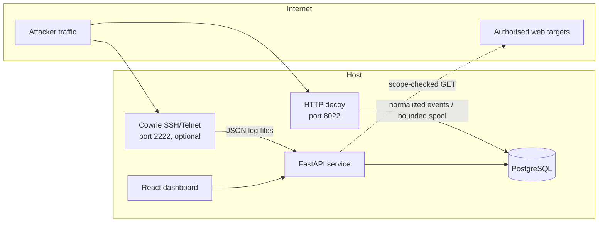
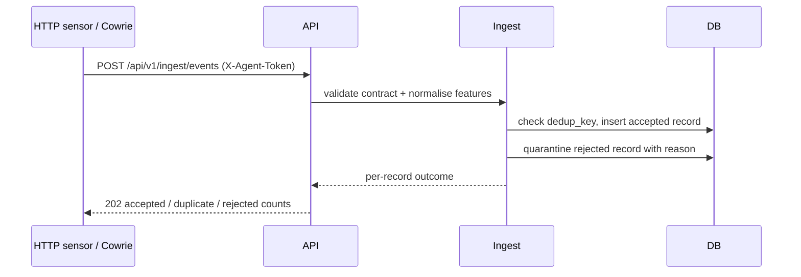
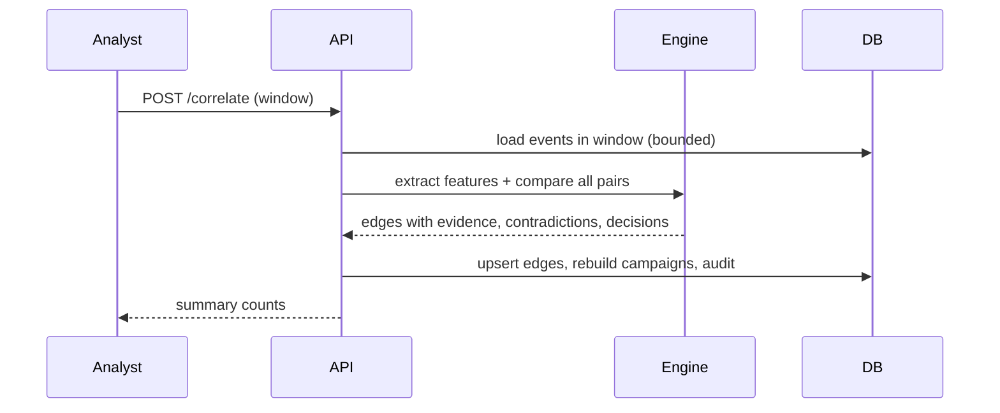

# Architecture

## Deployment shape

A modular monolith, one PostgreSQL database, a React single-page dashboard, and
decoy listeners that are network-reachable by attackers.

Ports: 8000 API (and the built dashboard), 8022 HTTP decoy
(`TP_DECOY_PORT`), 2222 Cowrie (optional Compose profile), 5173 dev dashboard,
5432 database (internal only). The Compose stack runs `db`, `app` and an
optional `cowrie` sensor; the HTTP decoy is a separate process started with the
CLI.

## Runtime components

| Component | Location | Responsibility |
| --- | --- | --- |
| Event contract | `app/schemas/event.py` | Validation, field bounds, canonicalisation |
| Ingestion | `app/telemetry/ingest.py` | Validate, normalise, deduplicate, persist, quarantine |
| Telemetry adapters | `app/telemetry/` | HTTP sensor, Cowrie JSON, web findings, decoy events |
| Correlation | `app/correlation/` | Session features, family scoring, graph edges, campaigns |
| Risk | `app/risk/scoring.py` | Severity, asset risk, journey escalation |
| Deception | `app/deception/` | Decoy profiles, uncertainty-directed investigation |
| Web assessment | `app/websec/` | Scope, SSRF guards, non-destructive checks |
| Digital assets | `app/cryptointel/` | Quotes, signals, asset exposure |
| Response | `app/response/` | Policy decisions, approvals, expiry, rollback |
| Auth/RBAC | `app/auth/` | Password hashing, HS256 tokens, roles, audit |
| API | `app/api/` | Versioned JSON endpoints |
| Dashboard | `frontend/` | Analyst-facing views |

## Request flow: telemetry ingestion

Deduplication uses a SHA-256 over the stable event fields, so replaying a sensor
buffer is safe and idempotent. A malformed record is rejected as a whole and
written to `event_quarantine`; it is never stored partially. Correlation is a
separate analyst-triggered step, so ingestion never blocks on graph work.

## Request flow: correlation

Correlation is deterministic for a fixed window, corpus and algorithm version.
It is bounded to the 400 most recent sessions (`MAX_SESSIONS_PER_RUN`) so an
analyst cannot trigger an unbounded quadratic computation; truncation is
reported in the run summary.

## Data model

`events` — normalised observation, unique `dedup_key`.
`graph_nodes` — sessions, IPs, assets, indicators and campaigns.
`graph_edges` — observed relationships and scored session pairs, with evidence,
contradictions, status and expiry.
`campaigns` — linked session clusters with summary and confidence.
`correlation_runs` — window, algorithm version and run metrics.
`investigations` — adaptive record including the persisted activation IP and
expiry, so the API and the separate decoy process agree.
`decoy_profiles`, `source_health` — allowed profiles and collector freshness.
`scans`, `findings`, `watch_scopes` — scope-limited assessment results.
`responses` — proposed action, policy decision, approval, expiry, rollback.
`crypto_snapshots`, `crypto_risk` — observed market facts and inferred scores.
`users`, `agent_tokens`, `audit_log`, `feedback` — identity and accountability.

JSON documents are stored as text only where they are written and read as a
whole; anything queried or constrained is a typed column.

## Adaptive activation

`POST /investigations/{id}/activate` writes the observation source IP and an
expiry onto the investigation row. The HTTP decoy is a separate process and
loads that row for each request, so an activation made through the API reaches
the listener without shared memory. Evaluation marks the investigation
`evaluated` and clears the expiry. Activations past their TTL are marked
`expired` on the next read or write, release their subject for a new
investigation and stop overriding the decoy profile. At most one investigation
is open per subject: partial unique indexes cover the `planned` and `active`
rows, so the limit holds even when two requests are planned at the same moment.

## Security boundaries

- The API is split into public (`/api/v1/health`, `/api/v1/health/ready`,
  `/api/v1/auth/login`), sensor (`X-Agent-Token`, hashed and revocable), and
  analyst (bearer token + RBAC) surfaces.
- Bearer tokens carry a per-account session version that is checked on every
  request. Changing a password increments the version, which revokes all
  tokens issued earlier; the caller receives a replacement token so the
  session performing the change continues without a re-login.
- Decoy listeners share the database but not an event loop or request context
  with the API. The HTTP decoy writes events directly and spools to disk if the
  pipeline is unavailable; Cowrie logs are tailed with a persisted offset.
- Web assessment runs through a single scope gate and SSRF guard, including on
  every redirect.
- The dashboard is a static build; the token lives in `sessionStorage`, is
  cleared on logout, and the CSP forbids inline script and external origins.

## Failure behaviour

| Failure | Behaviour |
| --- | --- |
| Database unavailable | Readiness returns 503; data endpoints fail without partial writes |
| Sensor token invalid or revoked | 401, nothing stored |
| Correlation window too large | The 400 most recent sessions are used; truncation is reported in the run summary |
| Web target out of scope | 403 before any connection |
| Web target private address | 403 unless local test explicitly enabled |
| Decoy request body large | Rejected with 413 at the configured bound |
| Response without approval | Blocked at execution, state `pending_approval` |
| Rollback of expired action | Rejected by state machine, 409 |

## Capacity

Correlation is quadratic in the number of sessions: the 400-session cap implies
79,800 pairs. The evaluation's 165-session volume run (13,530 pairs) took 18.7 s
and peaked at 112 MB, so a full capped run takes roughly a minute on one core.
The cap keeps a request bounded. Additional throughput would come from
restricting pairs by shared low-specificity keys, which is the next step if the
cap becomes restrictive.
